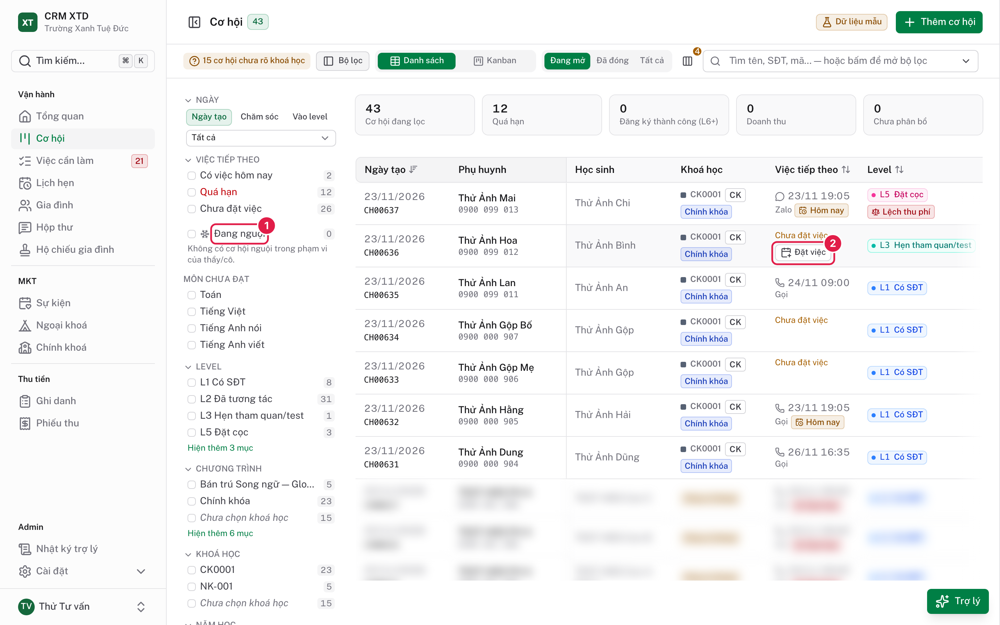

# Chăm sóc lại cơ hội nguội

> Tìm các cơ hội lâu không ai chạm tới và kéo chúng trở lại. Dành cho người phụ trách và trưởng nhóm.

__Khi nào dùng:__ đầu tuần, hoặc khi danh sách cơ hội có nhiều nhãn «Nguội».

__Trước khi bắt đầu:__ nhãn nguội chỉ để nhắc. Nó không đổi level, không giao lại cơ hội, không gửi thông báo.

## Cơ hội nguội là gì

Cơ hội **nguội** khi đủ cả bốn điều:

1. Đang chăm.
2. Level hiện tại có ngưỡng nguội (quản trị đặt; trống hoặc 0 là tắt).
3. Từ lần tương tác gần nhất tới nay đã quá số ngày đó. Tương tác là: ghi chăm sóc, xong việc tiếp theo, đổi level, ghi lịch hẹn đã đến; chưa có thì tính từ ngày tiếp nhận.
4. Không có việc tiếp theo hay lịch hẹn nào ở tương lai.

Ngưỡng mặc định trên phần mềm: L1, L2, L2B, L2C là 7 ngày; L3, L4, L4A, L4B là 5 ngày; L5 là 3 ngày.

## Các bước

1. Vào «Cơ hội». Ở cột bộ lọc bên trái chọn «Đang nguội»; hoặc ở nhóm «Việc tiếp theo» chọn «Quá hạn» hay «Chưa đặt việc».
2. Hoặc bấm ô tìm kiếm, ở cột «Lọc nhanh» chọn «Quá 7 ngày chưa chăm sóc», «Chưa chăm sóc lần nào» hay «Đứng level quá 14 ngày».
3. Mở từng cơ hội. Nhãn «Nguội {n} ngày» cho biết đã bao lâu; khung chi tiết báo "Không cập nhật từ {ngày}. Đặt việc tiếp theo?".
4. Gọi hoặc nhắn phụ huynh, ghi kết quả, rồi đặt việc tiếp theo.
   → *Kết quả:* nhãn nguội mất.
5. Trưởng nhóm: tick các dòng để giao hàng loạt cho người khác. Xem [Giao cơ hội chưa phân bổ, giao hàng loạt](./giao-co-hoi-chua-phan-bo.md).

| # | Vùng trên màn hình | Thao tác |
|---|---|---|
| (1) | «Đang nguội» | Lọc cơ hội nguội |
| (2) | «Đặt việc» | Rê chuột lên dòng, đặt việc tiếp theo ngay tại đó |

Hệ thống cũng tự tạo việc «Gọi lại» mỗi sáng cho cơ hội quá 7 ngày chưa chăm sóc; việc đó hiện ở [Việc cần làm](./man-viec-can-lam.md).

> **Phần mềm hiện tại:** lọc nhanh "Quá 7 ngày chưa chăm sóc" dùng cố định 7 ngày, khác ngưỡng nguội riêng của từng level. Đặc tả còn hai bộ lọc phần mềm chưa có: "Đã hẹn nhưng không còn lịch hẹn" và "Việc tiếp theo xa hơn 30 ngày".

__Liên quan:__ [Đặt và hoàn thành việc tiếp theo](./dat-viec-tiep-theo.md) · [Ghi cuộc gọi, Zalo, ghi chú chăm sóc](./ghi-cuoc-goi-zalo-ghi-chu.md) · [Cấu hình bộ level và danh mục lý do](./cau-hinh-bo-level-va-ly-do.md)
