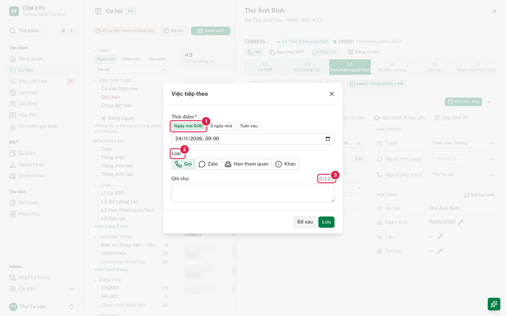

# Đặt và hoàn thành việc tiếp theo của cơ hội

> Mỗi cơ hội đang chăm nên có một việc tiếp theo: lúc nào làm gì với phụ huynh. Trang này hướng dẫn đặt, dời và đánh dấu xong.

__Khi nào dùng:__ sau mỗi lần chăm sóc, để không bỏ sót phụ huynh. Việc tiếp theo là bước kế tiếp **của cơ hội**; việc giao cho một người cụ thể có hạn là [việc cần làm](./man-viec-can-lam.md).

__Trước khi bắt đầu:__ cơ hội đang chăm (chưa đóng, chưa nhập học) và trong phạm vi của bạn.

Mỗi cơ hội có **tối đa một** việc tiếp theo. Đặt việc mới thì việc cũ bị thay. Việc tiếp theo không bắt buộc và không chặn đổi level.

## Đặt việc tiếp theo

1. Mở cơ hội, mở khung «Việc tiếp theo» dưới khung trạng thái, bấm «Đặt việc tiếp».
2. Chọn «Thời điểm», hoặc bấm nút chọn nhanh: «Chiều nay» (chỉ có trước 13:30), «Ngày mai 9:00», «3 ngày nữa», «Tuần sau».
3. Chọn «Loại»: «Gọi», «Zalo», «Hẹn tham quan» hoặc «Khác».
4. Ghi «Ghi chú» ngắn, tối đa 120 ký tự, rồi bấm «Lưu».
   → *Kết quả:* báo "Đã lưu việc tiếp theo."; cơ hội hiện nhãn «Hôm nay» hoặc «Quá hạn» khi tới giờ.

| # | Vùng trên màn hình | Thao tác |
|---|---|---|
| (1) | Nút chọn giờ nhanh | Chọn nhanh thời điểm |
| (2) | «Loại» | Chọn loại việc |
| (3) | Bộ đếm "n/120" | Ghi chú quá 120 ký tự thì bộ đếm đỏ, chưa lưu được |

## Dời hoặc đánh dấu xong

- Muốn đổi giờ: bấm «Dời lịch», chọn thời điểm mới, bấm «Lưu». Loại và ghi chú giữ nguyên.
- Làm xong: bấm «Xong».
  → *Kết quả:* báo "Đã xong việc."; hệ thống hỏi "Việc đã xong. Đặt việc tiếp theo?". Bấm «Để sau» thì cơ hội không có việc tiếp theo; hệ thống không tự đặt việc mới.

Hệ thống gợi ý đặt việc tiếp theo sau khi bạn đổi level lên L3 trở lên ("Đã đổi bước. Đặt việc tiếp theo?"). Bỏ qua gợi ý không sao.

Khi cơ hội sang nhóm đã đóng hoặc nhập học, việc tiếp theo tự bị xoá; mở lại cơ hội không khôi phục việc cũ.

Việc «Gọi lại» do hệ thống tạo mỗi sáng sẽ tự đặt «Việc tiếp theo» cho cơ hội đang trống việc.

__Xử lý khi lỗi:__ không lưu được vì ghi chú quá dài: rút còn 120 ký tự. Cơ hội đã đóng: mở lại cơ hội trước. Xem [Khi không giao việc, không ghi chăm sóc hoặc không đặt được lịch hẹn](./su-co-giao-viec-cham-soc-lich-hen.md).

__Liên quan:__ [Làm việc trong màn Việc cần làm](./man-viec-can-lam.md) · [Chăm sóc lại cơ hội nguội](./cham-soc-lai-co-hoi-nguoi.md) · [Ghi cuộc gọi, Zalo, ghi chú chăm sóc](./ghi-cuoc-goi-zalo-ghi-chu.md)
