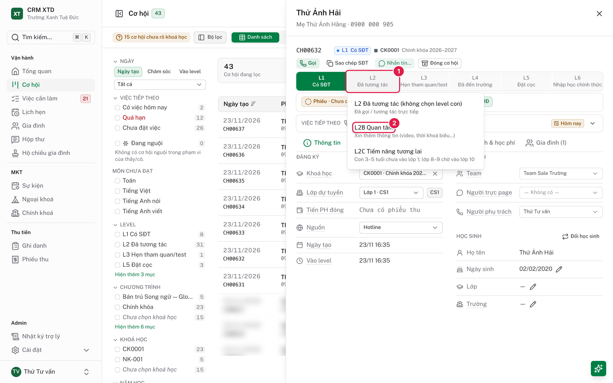

# Đổi level theo tiến trình chăm sóc

> Khi phụ huynh tiến thêm một bước, bạn đổi level cho cơ hội. Trang này hướng dẫn đổi level thường ngày, đóng cơ hội không phù hợp, và xem lịch sử đổi level.

__Khi nào dùng:__ sau cuộc gọi phụ huynh quan tâm, khi hẹn được lịch, khi phụ huynh đã tới trường, hoặc khi phụ huynh không phù hợp. Muốn chọn Đặt cọc hay Nhập học khi kế toán chưa ghi tiền thì xem [Lên tay Đặt cọc hoặc Nhập học](./len-tay-dat-coc-nhap-hoc.md); muốn lùi hay mở lại thì xem [Lùi level, đóng hoặc mở lại cơ hội](./lui-dong-mo-lai-co-hoi.md).

__Trước khi bắt đầu:__ bạn có quyền đổi level (tư vấn, trực page, trưởng nhóm, quản trị), cơ hội trong phạm vi của bạn.

## Đổi sang level kế tiếp

1. Mở cơ hội. Thanh level hiện các bậc L1 tới L6; level con đang chọn hiện dưới bậc của nó, vd "L4B Test đạt, chưa chốt".
2. Bấm bậc muốn chuyển.
   - Bậc có level con (L2, L4) mở danh sách level con. Chọn level con, hoặc dòng "… (không chọn level con)" để ở level chính.
   - Level cần lý do ghi "Sẽ hỏi lý do".
   → *Kết quả:* báo "Đã chuyển {mã} sang {level}" kèm nút «Hoàn tác».
3. Bấm nhầm thì bấm «Hoàn tác» trong 8 giây. Cơ hội trở về level cũ, lịch sử ghi "Hoàn tác lần đổi level vừa rồi".

«Hoàn tác» không có khi lần đổi có tạo lịch hẹn L3, khi đổi từ L3, khi đóng hay mở lại cơ hội.

| # | Vùng trên màn hình | Thao tác |
|---|---|---|
| (1) | Thanh level | Bấm bậc muốn chuyển |
| (2) | Danh sách level con | Chọn level con, hoặc dòng "(không chọn level con)" |

## Điều kiện ở từng bậc

| Chuyển sang | Cần gì | Xem |
|---|---|---|
| L2C Tiềm năng tương lai | Xác nhận năm học nhập học | [Các level và điều kiện vào](./tra-cuu-level-va-dieu-kien.md) |
| L3 Hẹn tham quan / test | Có chương trình, và đặt lịch hẹn ngay trong hộp chuyển | [Hẹn tham quan hoặc test](./hen-tham-quan-hoac-test.md) |
| L4 Đã đến trường | Có chương trình | [Ghi kết quả lịch hẹn](./ghi-ket-qua-lich-hen.md) |
| L4A, L4B | Đã có kết quả test tương ứng | [Ghi kết quả test đầu vào](./ghi-ket-qua-test-dau-vao.md) |
| L5, L6 | Thường tự đổi theo thu phí | [Level và thu phí](./level-va-thu-phi.md) |

## Đóng cơ hội không phù hợp

1. Bấm «Đóng cơ hội» ở đầu khung chi tiết.
   → *Kết quả:* hộp «Đóng cơ hội {mã}» ghi cơ hội sẽ chuyển sang L2A và rời danh sách «Đang mở».
2. Chọn «Lý do từ chối» (bắt buộc), ghi «Ghi chú thêm» nếu cần.
3. Bấm «Đóng cơ hội».
   → *Kết quả:* báo "Đã đóng {mã}" kèm lý do.

Cơ hội đã có phiếu thu hợp lệ thì không đóng sang L2A mà sang L7 Rút phí. Xem [Lùi level, đóng hoặc mở lại cơ hội](./lui-dong-mo-lai-co-hoi.md).

## Xem lịch sử đổi level

1. Mở cơ hội, chọn tab «Lịch sử», lọc «Đổi level».
   → Mỗi dòng ghi level cũ › level mới, nhãn «lùi» nếu chuyển về bậc thấp hơn, ngày giờ, người làm (hoặc «Hệ thống»), ghi chú hoặc lý do.
2. Tab «Thông tin» ghi ngày vào level hiện tại («Vào level»).

Lịch sử đổi level không ai sửa hay xoá được.

> **Phần mềm hiện tại:**
> - Đặc tả bắt ghi lý do khi **lùi level** (vd từ L3 về L2B); chưa kiểm phần mềm có hỏi lý do khi lùi ở các level ngoài level phí hay không.
> - Khi lên L3, phần mềm chưa kiểm năm học nhập học và lớp dự tuyển như đặc tả.
> - Đặc tả: hai người đổi cùng lúc thì người lưu sau được báo "Level vừa được {người} đổi sang {level} lúc {giờ}"; chưa kiểm trên phần mềm.

__Xử lý khi lỗi:__ [Khi không đổi được level](./su-co-doi-level.md)

__Liên quan:__ [Bộ level và hành trình của một cơ hội](./bo-level-va-hanh-trinh-co-hoi.md) · [Đặt và hoàn thành việc tiếp theo](./dat-viec-tiep-theo.md)
