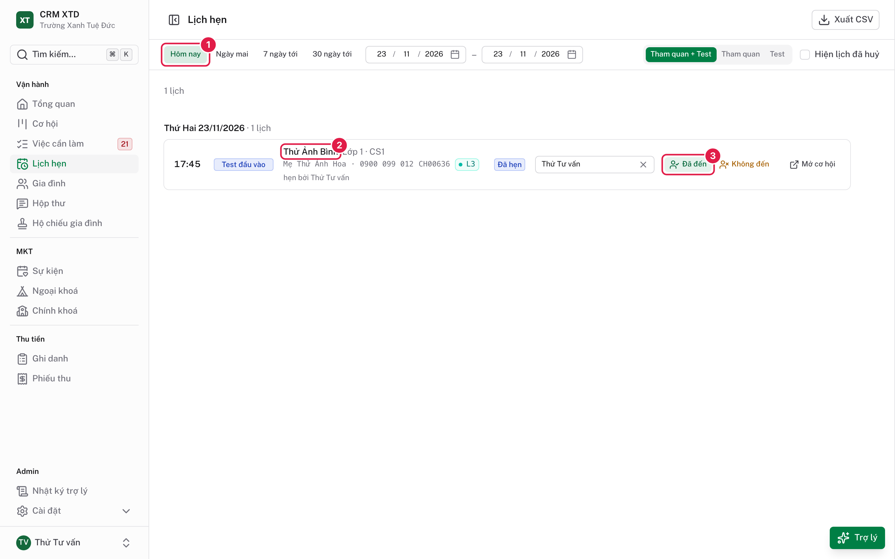

# Ghi kết quả lịch hẹn: đã đến, không đến, huỷ

> Sau giờ hẹn, người tiếp đón hoặc người phụ trách ghi phụ huynh đã đến hay không đến, để cơ hội đi tiếp đúng bước.

__Khi nào dùng:__ phụ huynh đã tới trường, hoặc quá giờ mà không tới, hoặc lịch bị huỷ.

__Trước khi bắt đầu:__ bạn là người tiếp đón của lịch, hoặc người phụ trách cơ hội, tư vấn, trưởng nhóm. Theo bảng quyền mặc định, trực page không ghi kết quả lịch hẹn.

## Ghi trên màn Lịch hẹn

1. Vào menu «Lịch hẹn». Chọn khoảng ngày «Hôm nay», «Ngày mai», «7 ngày tới» hoặc «30 ngày tới»; chọn loại «Tham quan + Test», «Tham quan» hoặc «Test».
2. Lịch quá giờ hơn 2 tiếng mà chưa ghi nằm ở nhóm "Quá hạn chưa cập nhật". Ghi các lịch này trước.
3. Bấm «Đã đến» hoặc «Không đến» trên dòng lịch.
   → *Kết quả:* báo "{học sinh}: đã đến" hoặc "{học sinh}: không đến".

| # | Vùng trên màn hình | Thao tác |
|---|---|---|
| (1) | Khoảng ngày | Chọn ngày cần xem |
| (2) | Dòng lịch hẹn | Giờ, loại hẹn, học sinh, phụ huynh, level, người đón |
| (3) | «Đã đến» / «Không đến» | Ghi kết quả |

## Ghi trong cơ hội

1. Mở cơ hội, chọn tab «Hẹn & việc».
2. Ở lịch đang «Đã hẹn», bấm «Ghi kết quả», ghi «Điểm / mức» và nhận xét nếu có, rồi bấm «Đã đến» (lịch học thử là «Đã học»).
3. Phụ huynh không tới thì bấm «Không đến». Lịch bị huỷ thì bấm «Huỷ».

«Đã đến» chỉ bấm được từ 2 tiếng trước giờ hẹn; sớm hơn sẽ thấy "Chưa tới giờ hẹn".

## Sau khi ghi

| Bạn ghi | Hệ thống làm |
|---|---|
| Đã đến | Cơ hội chính khoá đang dưới L4 tự lên L4, báo "Cơ hội lên L4 (đã đến trường)". Lịch test thì ghi tiếp điểm: [Ghi kết quả test đầu vào](./ghi-ket-qua-test-dau-vao.md) |
| Không đến | Tạo việc "Gọi lại — không đến …" hạn cuối ngày làm việc kế tiếp, giao người phụ trách |
| Huỷ | Lịch chuyển Đã huỷ |

## Nếu bạn chỉ là người đón

Bạn thấy lịch mình đón trên màn «Lịch hẹn»: tên học sinh, phụ huynh (không có số điện thoại), mã cơ hội. Bạn bấm được «Đã đến», «Không đến». Bạn không đổi được giờ hẹn, người đón, hay huỷ lịch; nhờ người phụ trách cơ hội làm.

> **Phần mềm hiện tại:**
> - Đặc tả có **dời lịch** (đổi giờ, giữ trạng thái Đã hẹn); phần mềm chưa có nút dời. Cần dời thì huỷ lịch cũ rồi hẹn lịch mới.
> - Đặc tả bắt **chọn lý do khi huỷ**; phần mềm huỷ ngay, không hỏi lại. Bấm «Huỷ» cẩn thận.
> - Đặc tả: ghi Đã đến **không** tự đổi level, chỉ gợi ý; phần mềm tự đưa cơ hội chính khoá lên L4.
> - Đặc tả cho ghi kết quả từ ngày hẹn; phần mềm cho từ 2 tiếng trước giờ hẹn.

__Liên quan:__ [Hẹn tham quan hoặc test và giao người tiếp đón](./hen-tham-quan-hoac-test.md) · [Đổi level theo tiến trình chăm sóc](./doi-level.md) · [Làm việc trong màn Việc cần làm](./man-viec-can-lam.md)
