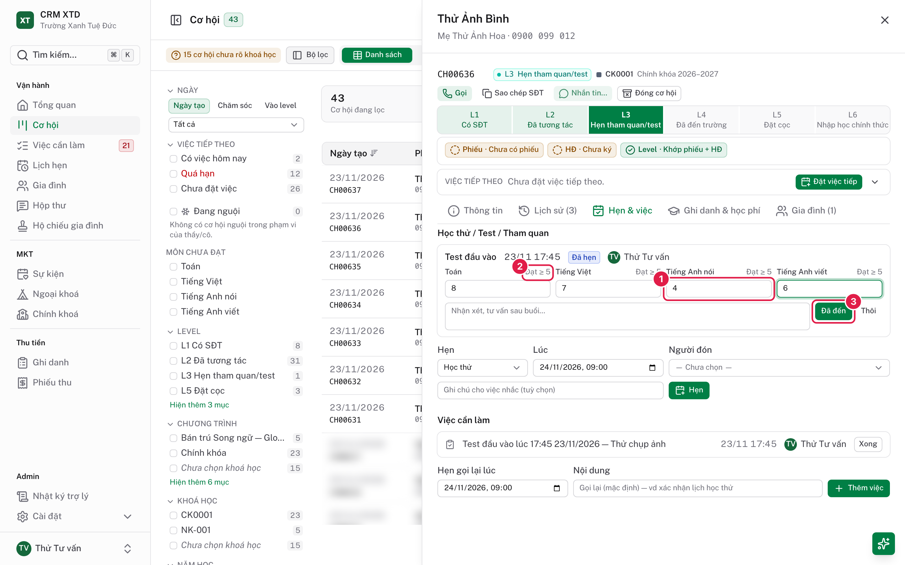

# Ghi kết quả test đầu vào

> Sau buổi test, bạn ghi điểm từng môn để cơ hội sang đúng level Test đạt hoặc Test không đạt.

__Khi nào dùng:__ học sinh đã làm bài test đầu vào theo lịch «Test đầu vào».

__Trước khi bắt đầu:__

- Cơ hội có chương trình có test đầu vào, và có lịch hẹn loại «Test đầu vào».
- Bạn là tư vấn, trưởng nhóm hoặc quản trị. Theo bảng quyền mặc định, trực page không ghi kết quả test.
- Quản trị đã bật môn và đặt ngưỡng đạt ở Cài đặt, mục «Ngưỡng đạt test đầu vào».

## Các bước

1. Mở cơ hội, chọn tab «Hẹn & việc», tới lịch «Test đầu vào», bấm «Ghi kết quả».
   → *Kết quả:* mỗi môn có một ô điểm, kèm ngưỡng "Đạt ≥ …".
2. Nhập điểm từng môn, từ 0 tới 10.
3. Bấm «Đã đến».
   → *Kết quả:* mỗi môn hiện «Đạt» hoặc «Chưa đạt».
   - Đạt mọi môn: cơ hội tự sang L4B, báo "Đạt mọi môn — cơ hội lên L4B (test đạt, chưa chốt)".
   - Có môn chưa đạt: lịch sử ghi "Kết quả test: … (chưa đạt: …)". Cơ hội hiện trong bộ lọc «Môn chưa đạt».

| # | Vùng trên màn hình | Thao tác |
|---|---|---|
| (1) | Ô điểm | Nhập điểm 0 tới 10 |
| (2) | "Đạt ≥ …" | Ngưỡng đạt của môn |
| (3) | «Đã đến» | Lưu kết quả |

Điểm chấm lại cũng ghi được sau khi đã bấm «Đã đến»; đạt mọi môn thì cơ hội vẫn tự sang L4B.

> **Phần mềm hiện tại:**
> - Có môn chưa đạt thì phần mềm **chưa tự chuyển sang L4A** như đặc tả. Bạn chọn L4A trên thanh level.
> - Đặc tả ghi kết quả chung đạt / không đạt kèm ảnh bài test; phần mềm ghi điểm từng môn, chưa có ảnh bài test.
> - Chưa thấy giới hạn số lần test, và chưa thấy cách sửa hay huỷ một lần test có lý do.

__Xử lý khi lỗi:__

| Bạn thấy | Làm gì |
|---|---|
| "Điểm phải là số từ 0 đến 10" | Sửa ô điểm bị đánh dấu |
| "Chưa có môn test nào đang bật…" | Nhờ quản trị bật môn và đặt ngưỡng ở Cài đặt |
| Ô nói "điểm / mức chung, không chấm theo môn" | Lịch này không phải loại Test đầu vào; hẹn lại đúng loại |

__Liên quan:__ [Ghi kết quả lịch hẹn](./ghi-ket-qua-lich-hen.md) · [Đổi level theo tiến trình chăm sóc](./doi-level.md) · [Các level và điều kiện vào từng level](./tra-cuu-level-va-dieu-kien.md)
