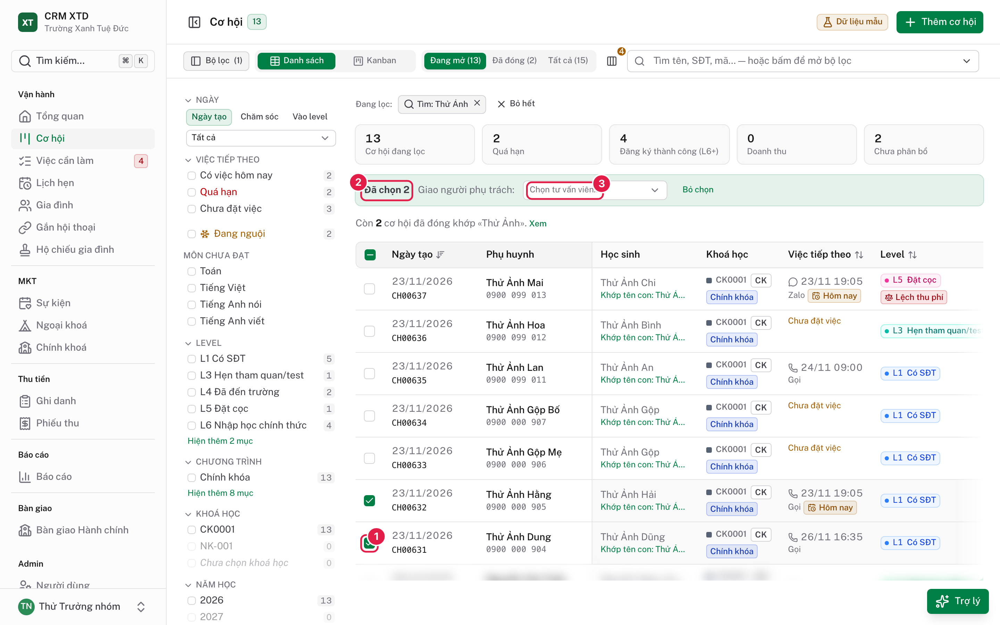

# Giao cơ hội chưa phân bổ, giao hàng loạt

> Trưởng nhóm giao các cơ hội chưa có người phụ trách, hoặc chuyển nhiều cơ hội cho một tư vấn cùng lúc.

__Khi nào dùng:__ có cơ hội mới chưa ai nhận (vd từ import), một tư vấn nghỉ, hoặc cần chia lại việc trong đội.

__Trước khi bắt đầu:__ bạn có quyền giao người (trưởng nhóm, quản trị). Chỉ giao được cơ hội đang chăm trong phạm vi của bạn.

## Các bước

1. Vào «Cơ hội». Bấm ô số «Chưa phân bổ» để lọc, hoặc mở ô tìm kiếm, ở «Lọc nhanh» chọn «Chưa phân bổ».
   → *Kết quả:* danh sách cơ hội đã có số điện thoại, chưa đóng, chưa đăng ký mà chưa có người phụ trách.
2. Tick các dòng cần giao.
   → *Kết quả:* thanh "Đã chọn {n}" hiện ra.
3. Ở "Giao người phụ trách:", chọn người trong "Chọn tư vấn viên…".
   → *Kết quả:* hộp «Đổi người phụ trách» ghi "{n} cơ hội → {tên}".
4. Nhập «Lý do» (bắt buộc), bấm «Đổi người phụ trách».
   → *Kết quả:* báo "Đã giao {n} cơ hội cho {tên}"; các cơ hội ra khỏi bộ lọc «Chưa phân bổ».

Muốn bỏ hết dòng đã tick thì bấm «Bỏ chọn». Bạn chỉ chọn được trong trang đang xem; đổi bộ lọc thì mất các dòng đã tick.

Cũng làm như trên từ các bộ lọc chăm sóc lại (vd «Đang nguội») để chuyển cơ hội bị bỏ quên cho người khác.

| # | Vùng trên màn hình | Thao tác |
|---|---|---|
| (1) | Ô tick | Chọn cơ hội cần giao |
| (2) | "Đã chọn {n}" | Số cơ hội đang chọn |
| (3) | "Chọn tư vấn viên…" | Chọn người nhận |

> **Phần mềm hiện tại:**
> - Đặc tả cho giao lần lượt cho nhiều người, hoặc chuyển cả lô sang một đội; phần mềm chỉ giao cho một người.
> - Đặc tả có hàng chờ riêng của từng đội và hàng chờ chung (cơ hội chưa có đội); phần mềm có một ô «Chưa phân bổ».
> - Đặc tả: cơ hội không giao được (đã đóng, vừa được người khác giao) bị bỏ qua và liệt kê kèm lý do; chưa kiểm trên phần mềm.
> - Lý do gõ tự do, chưa chọn trong danh mục như đặc tả.

__Liên quan:__ [Đổi người phụ trách cơ hội kèm lý do](./doi-nguoi-phu-trach.md) · [Người phụ trách, người trực page và phạm vi xem](./nguoi-phu-trach-va-pham-vi-xem.md) · [Chăm sóc lại cơ hội nguội](./cham-soc-lai-co-hoi-nguoi.md)
