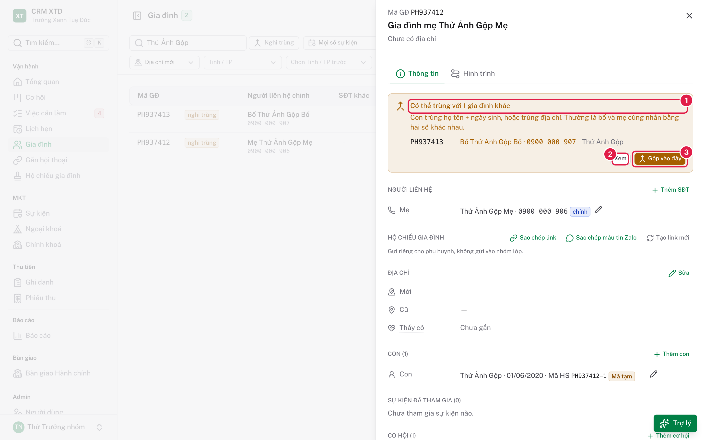

# Gộp hai gia đình trùng

> Khi bố và mẹ cùng liên hệ bằng hai số khác nhau, CRM có thể có hai hồ sơ cho cùng một nhà. Trưởng nhóm hoặc quản trị gộp hai hồ sơ thành một.

> **Cảnh báo:** gộp xong **không tách lại được**. Hồ sơ bị gộp sẽ mất, mọi thứ chuyển sang hồ sơ giữ lại. Kiểm kỹ trước khi bấm.

__Khi nào dùng:__ hai hồ sơ có con trùng họ tên và ngày sinh, hoặc trùng địa chỉ, và bạn đã chắc là cùng một nhà.

__Trước khi bắt đầu:__ bạn là trưởng nhóm hoặc quản trị (quyền gộp gia đình), và cả hai gia đình trong phạm vi sửa của bạn.

## Trước khi gộp, kiểm

- [ ] Hai hồ sơ đúng là cùng một nhà (hỏi lại phụ huynh nếu chưa chắc).
- [ ] Bạn đang mở hồ sơ **muốn giữ lại**. Liên hệ chính, địa chỉ, ghi chú, team thầy cô của hồ sơ này được giữ.
- [ ] Bạn đã xem hồ sơ kia bằng nút «Xem».

## Các bước

1. Mở hồ sơ muốn giữ lại. Ở đầu tab «Thông tin», khung "Có thể trùng với {n} gia đình khác" liệt kê các hồ sơ nghi trùng.
2. Bấm «Xem» để mở và kiểm hồ sơ kia.
3. Quay lại hồ sơ giữ lại, bấm «Gộp vào đây» ở dòng hồ sơ kia.
   → *Kết quả:* hộp «Gộp gia đình» nói rõ mọi số điện thoại, học sinh, cơ hội của hồ sơ kia sẽ chuyển sang, rồi hồ sơ kia bị xoá.
4. Bấm «Gộp». Muốn thôi thì bấm «Huỷ», không gì thay đổi.
   → *Kết quả:* báo "Đã gộp gia đình".

| # | Vùng trên màn hình | Thao tác |
|---|---|---|
| (1) | Khung "Có thể trùng…" | Xem hồ sơ nào nghi trùng và vì sao |
| (2) | «Xem» | Mở hồ sơ kia để kiểm |
| (3) | «Gộp vào đây» | Gộp hồ sơ kia vào hồ sơ đang mở |

## Sau khi gộp

- Liên hệ chính của hồ sơ giữ lại giữ nguyên; liên hệ chính bên kia thành liên hệ phụ.
- Địa chỉ, ghi chú, team thầy cô bên kia (nếu khác) được chép vào ghi chú của hồ sơ giữ lại.
- Mã gia đình cũ vẫn tìm được và dẫn sang hồ sơ giữ lại. Lịch sử của hồ sơ bị gộp hiện trong lịch sử hồ sơ giữ lại. Mỗi cơ hội chuyển sang ghi "Gộp gia đình {A} vào {B}".
- Hệ thống không tự gộp học sinh. Hai con trùng tên là hai hồ sơ học sinh riêng: xoá học sinh nhập nhầm nếu chưa gắn gì, hoặc đóng cơ hội thừa.
- Gộp không đổi người phụ trách của các cơ hội.

> **Phần mềm hiện tại:** đặc tả có danh sách các cặp học sinh có thể trùng hiện ra sau khi gộp, để người gộp xử lý; phần mềm chưa thấy danh sách này. Sau khi gộp, bạn tự xem mục «Con» của hồ sơ giữ lại.

__Liên quan:__ [Tìm và xem hồ sơ gia đình](./tim-va-xem-ho-so-gia-dinh.md) · [Sửa người liên hệ và học sinh](./sua-nguoi-lien-he-va-hoc-sinh.md) · [Lùi level, đóng hoặc mở lại cơ hội](./lui-dong-mo-lai-co-hoi.md)
