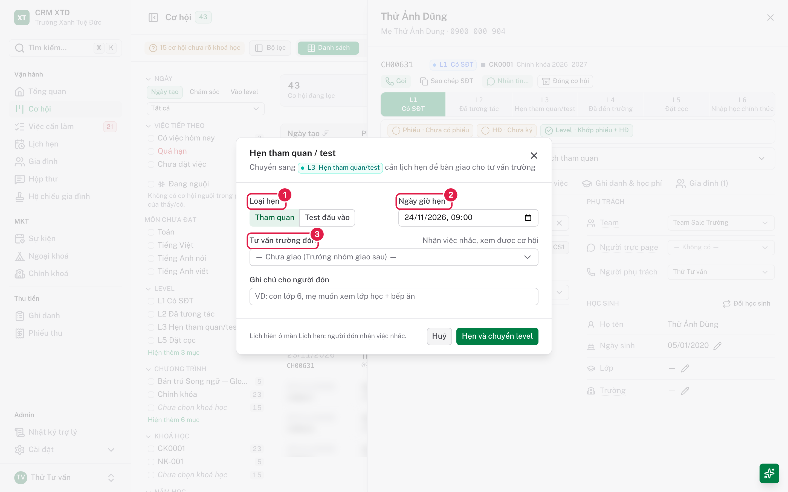

# Hẹn tham quan hoặc test và giao người tiếp đón

> Khi phụ huynh đồng ý tới trường, bạn đặt lịch hẹn và chọn người đón tại trường. Dành cho người phụ trách cơ hội (tư vấn, trực page) và trưởng nhóm.

__Khi nào dùng:__ phụ huynh hẹn tới trường tham quan, cho con làm test đầu vào, hoặc học thử.

__Trước khi bắt đầu:__

- Cơ hội đang chăm và trong phạm vi của bạn.
- Cơ hội đã có khoá học quan tâm (chương trình). Hẹn test chỉ dùng cho chương trình có test đầu vào.
- Hẹn tham quan hay test **không** đổi người phụ trách. Người tiếp đón chỉ đón lịch hẹn đó.

## Cách 1: hẹn và chuyển sang L3 cùng lúc

Dùng khi cơ hội đang ở L1 hoặc L2.

1. Mở cơ hội, chọn **L3** trên thanh level.
   → *Kết quả:* hộp «Hẹn tham quan / test» mở ra. Nếu báo "Chọn chương trình trước khi lên L3", chọn «Khoá học quan tâm» ở tab «Thông tin» rồi làm lại.
2. Chọn «Loại hẹn»: «Tham quan» hoặc «Test đầu vào».
3. Chọn «Ngày giờ hẹn».
4. Chọn người đón ở «Tư vấn trường đón». Chưa biết ai đón thì để «— Chưa giao (Trưởng nhóm giao sau) —».
5. Ghi «Ghi chú cho người đón» nếu cần (vd con lớp mấy, phụ huynh muốn xem gì), bấm «Hẹn và chuyển level».
   → *Kết quả:* cơ hội ở L3; báo "Đã tạo lịch hẹn và việc nhắc cho người đón". Lịch hiện ở màn «Lịch hẹn».

| # | Vùng trên màn hình | Thao tác |
|---|---|---|
| (1) | «Loại hẹn» | Chọn Tham quan hoặc Test đầu vào |
| (2) | «Ngày giờ hẹn» | Chọn ngày giờ phụ huynh tới |
| (3) | «Tư vấn trường đón» | Chọn người đón, hoặc để trưởng nhóm giao sau |

## Cách 2: thêm lịch hẹn cho cơ hội đã ở L3 trở lên

1. Mở cơ hội, chọn tab «Hẹn & việc», tới mục «Học thử / Test / Tham quan».
2. Ở «Hẹn» chọn «Học thử», «Test đầu vào» hoặc «Tham quan»; chọn giờ ở «Lúc»; chọn «Người đón».
3. Ghi chú nếu cần, bấm «Hẹn».
   → *Kết quả:* báo "Đã hẹn {loại} — đã tạo việc nhắc".

Ghi cuộc gọi với kết quả «Hẹn tham quan / test» cũng mở form hẹn này. Xem [Ghi cuộc gọi, Zalo, ghi chú chăm sóc](./ghi-cuoc-goi-zalo-ghi-chu.md).

## Giao hoặc đổi người tiếp đón

1. Vào menu «Lịch hẹn», tìm lịch cần giao.
2. Chọn người ở ô người đón trên dòng lịch đó.
   → *Kết quả:* báo "Đã giao {tên} đón {học sinh}"; bỏ chọn thì báo "Đã bỏ người đón".

Người tiếp đón thấy lịch mình đón trên màn «Lịch hẹn» và ghi được đã đến hay không đến. Nếu không phải người phụ trách, người tiếp đón không mở được cơ hội.

> **Phần mềm hiện tại:**
> - Cùng một ô có hai tên: «Tư vấn trường đón» trong hộp chuyển L3, «Người đón» ở tab «Hẹn & việc».
> - Câu gợi ý "Nhận việc nhắc, xem được cơ hội" trong hộp chuyển L3 đã cũ. Theo quyết định 11/11, người đón không mở được cơ hội.
> - Đặc tả có ô điểm hẹn (TH–THCS hoặc THPT) và hỏi "dời lịch cũ hay tạo thêm" khi trùng lịch cùng loại; phần mềm chưa có. Phần mềm có thêm loại Học thử.
> - Khi lên L3, phần mềm chưa kiểm năm học nhập học và lớp dự tuyển như đặc tả.

__Xử lý khi lỗi:__ "Chọn ngày giờ hẹn": chọn giờ rồi lưu. "Chọn chương trình trước khi lên L3": gắn khoá học trước. Xem [Khi không đổi được level](./su-co-doi-level.md) và [Khi không giao việc, không ghi chăm sóc hoặc không đặt được lịch hẹn](./su-co-giao-viec-cham-soc-lich-hen.md).

__Liên quan:__ [Ghi kết quả lịch hẹn](./ghi-ket-qua-lich-hen.md) · [Ghi kết quả test đầu vào](./ghi-ket-qua-test-dau-vao.md) · [Đổi level theo tiến trình chăm sóc](./doi-level.md)
