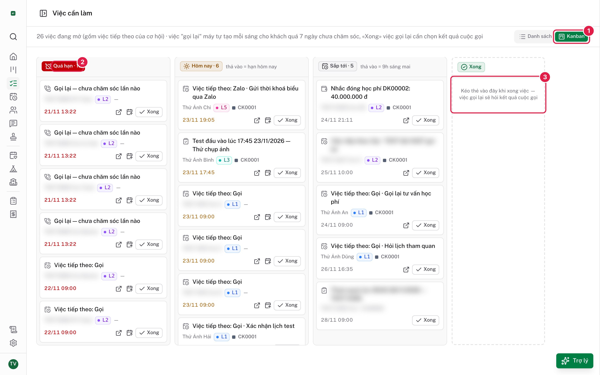

# Làm việc trong màn Việc cần làm

> Màn Việc cần làm gom mọi việc bạn phải làm: việc tiếp theo của cơ hội bạn phụ trách và việc gọi lại hệ thống tạo. Đầu ngày mở màn này trước.

__Khi nào dùng:__ đầu ngày và giữa ngày, để biết việc nào quá hạn, việc nào làm hôm nay.

__Trước khi bắt đầu:__ không cần quyền riêng; bạn thấy việc được giao cho mình. Số trên mục «Việc cần làm» ở menu là số việc quá hạn cộng việc hôm nay; số đỏ khi có việc quá hạn.

## Xem và xử lý việc

1. Vào menu «Việc cần làm».
2. Chọn cách xem «Danh sách» hoặc «Kanban». Việc chia nhóm «Quá hạn», «Hôm nay», «Sắp tới».
3. Với mỗi việc:
   - «Mở» (hoặc biểu tượng «Mở cơ hội») để vào cơ hội làm việc.
   - «Dời sang mai» để dời sang 9 giờ sáng mai.
   - «Xong» khi đã làm. Với việc «Gọi lại», hệ thống hỏi kết quả cuộc gọi trước khi đánh dấu xong.
   → *Kết quả:* báo "Đã xong việc" hoặc "Đã xong việc tiếp theo"; việc rời khỏi danh sách.
4. Ở dạng Kanban, kéo thẻ vào cột «Xong» khi xong việc, hoặc kéo sang cột khác để đổi hạn.

Hệ thống tự tạo việc «Gọi lại» mỗi sáng cho cơ hội quá 7 ngày chưa chăm sóc.

| # | Vùng trên màn hình | Thao tác |
|---|---|---|
| (1) | «Danh sách» / «Kanban» | Đổi cách xem |
| (2) | Cột «Quá hạn» | Việc cần làm trước |
| (3) | Cột «Xong» | Kéo thẻ vào khi xong việc |

## Dành cho trưởng nhóm: xem và giao việc của đội

1. Ở màn «Việc cần làm», chọn «Tất cả» thay cho «Của tôi».
   → *Kết quả:* thấy việc của cả đội, thêm nhóm «Chưa giao» gồm việc gọi lại chưa có người phụ trách.
2. Chọn các việc trong nhóm «Chưa giao», chọn người ở «Giao cho…», bấm «Giao N việc».
3. Nhập «Lý do» trong hộp «Đổi người phụ trách», xác nhận.
   → *Kết quả:* báo "Đã giao N việc cho {tên}".

> **Phần mềm hiện tại:** đặc tả cho trưởng nhóm lọc việc theo từng người phụ trách và giao một việc cần làm có hạn cho bất kỳ ai. Phần mềm chưa có bộ lọc theo người. Việc cần làm hiện chỉ tạo được ở tab «Hẹn & việc» của cơ hội (mục «Việc cần làm», nút «Thêm việc») và luôn giao cho người phụ trách cơ hội.

__Liên quan:__ [Đặt và hoàn thành việc tiếp theo](./dat-viec-tiep-theo.md) · [Ghi cuộc gọi, Zalo, ghi chú chăm sóc](./ghi-cuoc-goi-zalo-ghi-chu.md) · [Chăm sóc lại cơ hội nguội](./cham-soc-lai-co-hoi-nguoi.md)
