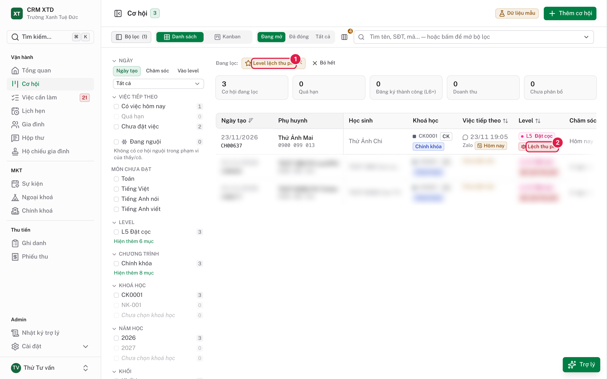

# Soát cơ hội lệch thu phí

> Tìm các cơ hội có level không khớp với tiền đã thu và đưa chúng về đúng. Dành cho kế toán và trưởng nhóm.

__Khi nào dùng:__ hằng ngày hoặc cuối ngày, sau khi lập, huỷ, hoàn phiếu thu.

__Trước khi bắt đầu:__ bạn là kế toán, trưởng nhóm hoặc quản trị. Đọc [Level và thu phí khớp nhau thế nào](./level-va-thu-phi.md) nếu chưa quen.

## Các bước

1. Vào «Cơ hội», bấm ô tìm kiếm, ở cột «Lọc nhanh» chọn «Level lệch thu phí».
   → *Kết quả:* danh sách các cơ hội lệch, mỗi dòng có nhãn «Lệch thu phí».
2. Rê chuột vào nhãn để xem lý do lệch, người và giờ gây lệch.
3. Mở cơ hội và xử lý theo lý do (bảng dưới). Trong chi tiết, nhãn level ghi "Level · Lệch thu phí"; dòng trạng thái có nút «Tạo phiếu thu» hoặc «Ghi nhận đã ký HĐ» khi phù hợp.
4. Xong một cơ hội thì nó tự ra khỏi danh sách khi tiền và level khớp lại.

| # | Vùng trên màn hình | Thao tác |
|---|---|---|
| (1) | «Level lệch thu phí» | Bật bộ lọc |
| (2) | «Lệch thu phí» | Nhãn trên dòng cơ hội lệch |

## Xử lý theo lý do lệch

| Lý do | Thường do | Cách xử lý |
|---|---|---|
| lên tay chưa đủ điều kiện | Tư vấn chọn Đặt cọc hoặc Nhập học trước khi có phiếu | Đã nhận tiền: kế toán lập phiếu thu. Chưa nhận: lùi level kèm lý do ([trang hướng dẫn](./lui-dong-mo-lai-co-hoi.md)) |
| phiếu đã huỷ chưa lập lại | Kế toán huỷ phiếu lập sai | Lập lại phiếu đúng |
| hoàn một phần | Hoàn một phần sau khi đã Nhập học | Kế toán quyết xử lý tiếp; cơ hội giữ L6 |
| còn khoản thu · dưới L5 | Cơ hội có tiền nhưng đang ở bậc thấp, vd đã bị lùi tay | Kiểm vì sao bị lùi; đúng thì [tính lại level](./tinh-lai-level.md) |

Cơ hội có level đặt bởi import không vào danh sách này.

> **Phần mềm hiện tại:** kế toán mặc định có quyền lùi level phí nhưng có thể chưa sửa được cơ hội trên thanh level; chưa kiểm. Việc nhắc kế toán sau 1 ngày làm việc chưa kiểm trên phần mềm.

__Liên quan:__ [Level và thu phí khớp nhau thế nào](./level-va-thu-phi.md) · [Lên tay Đặt cọc hoặc Nhập học](./len-tay-dat-coc-nhap-hoc.md) · [Tính lại level khi chưa khớp thu phí](./tinh-lai-level.md)
