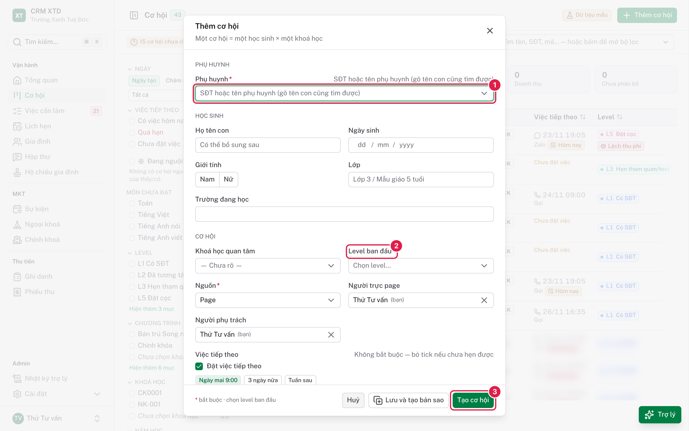

# Tạo cơ hội cho phụ huynh mới

> Khi một phụ huynh để lại số điện thoại lần đầu, bạn tạo cùng lúc gia đình, phụ huynh, học sinh và cơ hội. Dành cho trực page và tư vấn.

__Khi nào dùng:__ phụ huynh nhắn page, gọi hotline hoặc được giới thiệu, và số điện thoại **chưa có** trong CRM. Số đã có thì xem [Thêm cơ hội mới cho gia đình đã có](./them-co-hoi-gia-dinh-da-co.md).

__Trước khi bắt đầu:__ bạn có quyền tạo cơ hội (tư vấn, trực page, trưởng nhóm, quản trị) và có số điện thoại của phụ huynh. Gia đình, phụ huynh, học sinh, cơ hội chỉ được lưu khi bạn bấm «Tạo cơ hội»; gặp lỗi thì không lưu gì.

## Các bước

1. Vào «Cơ hội», bấm «Thêm cơ hội» (hoặc bấm phím N, hoặc nút + ở «Tổng quan»).
   → *Kết quả:* hộp «Thêm cơ hội» mở ra.
2. Ở ô «Phụ huynh», **gõ số điện thoại trước**.
   - Có dòng gắn nhãn «Có thể trùng»: có thể phụ huynh đã có trong CRM. Xem kỹ trước khi tạo mới.
   - Không có gì khớp: hiện "Không thấy «…». Chữ vừa gõ là:". Chọn «Đây là SĐT».
3. Trong hộp «Tạo phụ huynh», điền «Họ tên phụ huynh», chọn quan hệ (Mẹ, Bố, Ông, Bà, Khác), kiểm «Số điện thoại», điền tên và lớp của con nếu biết, bấm «Xong».
   → *Kết quả:* form hiện "Phụ huynh mới: …".
4. Ở phần học sinh, bổ sung «Họ tên con», «Ngày sinh», «Giới tính», «Lớp», «Trường đang học» nếu có.
5. Ở phần cơ hội:
   - «Level ban đầu» (bắt buộc): «L1 Có SĐT», «L2 Đã tương tác» hoặc «L3 Hẹn tham quan/test». Không có level chọn sẵn.
   - «Nguồn» (bắt buộc).
   - «Khoá học quan tâm»: bắt buộc nếu chọn L3. Chọn khoá chính khoá thì có thêm «Lớp dự tuyển».
   - «Người trực page» (chỉ hiện với nguồn page) và «Người phụ trách». Mặc định bạn là người phụ trách, ghi «(bạn)».
   - «Việc tiếp theo»: mặc định có tick «Đặt việc tiếp theo»; bỏ tick nếu chưa hẹn được.
   - «Ghi chú»: nhu cầu, băn khoăn của phụ huynh.
6. Chọn L3 thì điền thêm phần lịch hẹn tham quan hoặc test.
7. Bấm «Tạo cơ hội».
   → *Kết quả:* báo "Đã tạo cơ hội"; chi tiết cơ hội mở ra.

Muốn tạo tiếp cơ hội cho con khác hoặc khoá khác của cùng gia đình, bấm «Lưu và tạo bản sao» thay cho «Tạo cơ hội». Form giữ gia đình, nguồn, người phụ trách, người trực page; bỏ học sinh, khoá, level, lịch hẹn.

Chưa nhập tên con thì hệ thống nhắc "Chưa có học sinh". Bấm «Nhập tên con» để nhập luôn, hoặc «Vẫn tạo» rồi bổ sung sau bằng nút «Thêm học sinh».

| # | Vùng trên màn hình | Thao tác |
|---|---|---|
| (1) | «Phụ huynh» | Gõ số điện thoại trước để tránh tạo trùng |
| (2) | «Level ban đầu» | Chọn L1, L2 hoặc L3 |
| (3) | «Tạo cơ hội» / «Lưu và tạo bản sao» | Lưu, hoặc lưu rồi tạo tiếp cho cùng gia đình |

> **Phần mềm hiện tại:**
> - Đặc tả có ô **ngày tiếp nhận** (mặc định hôm nay, chỉ trưởng nhóm sửa) và **năm học nhập học** (mặc định năm học kế tiếp) trên form; phần mềm chưa có hai ô này.
> - Đặc tả giao người phụ trách theo đội mặc định của nguồn (nguồn page cho đội trực page, nguồn khác cho đội trường); người tạo không thuộc đội đó thì cơ hội vào hàng chờ của đội. Phần mềm đang đặt người tạo làm người phụ trách.
> - Đặc tả bắt tên học sinh khi tạo; phần mềm cho bổ sung sau.

__Xử lý khi lỗi:__ báo SĐT đã thuộc gia đình khác, hoặc học sinh đã có cơ hội đang mở: xem [Khi không tạo hoặc không sửa được hồ sơ, cơ hội](./su-co-ho-so-va-co-hoi.md).

__Liên quan:__ [Thêm cơ hội mới cho gia đình đã có](./them-co-hoi-gia-dinh-da-co.md) · [Ghi cuộc gọi, Zalo, ghi chú chăm sóc](./ghi-cuoc-goi-zalo-ghi-chu.md) · [Bắt đầu nhanh](./bat-dau-nhanh.md)
