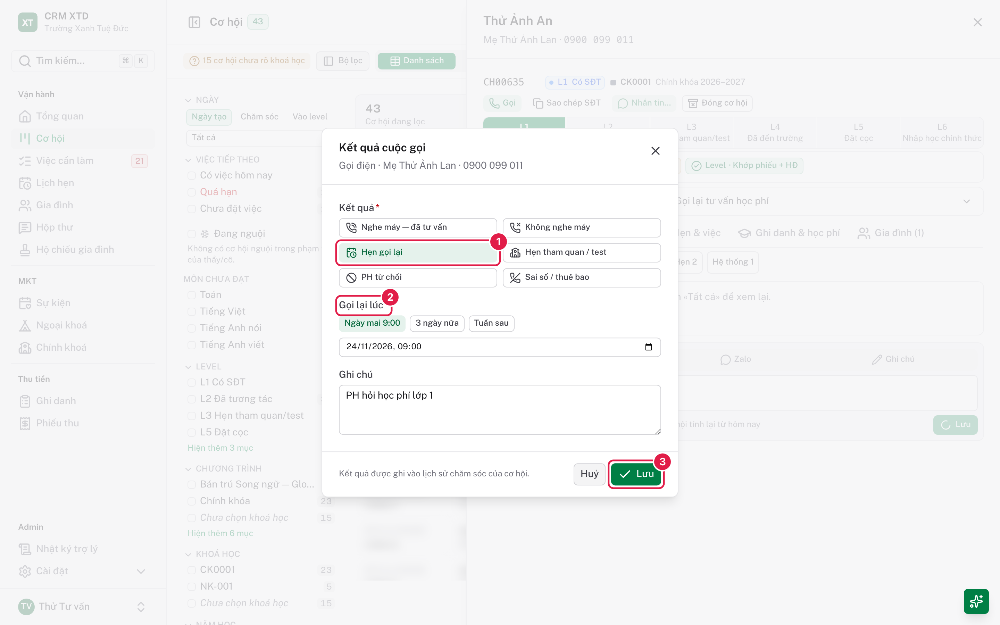

# Ghi cuộc gọi, Zalo, ghi chú chăm sóc

> Ghi lại mỗi lần bạn gọi, nhắn Zalo hay có thông tin mới về phụ huynh, để ai mở cơ hội cũng đọc được câu chuyện.

__Khi nào dùng:__ ngay sau khi gọi điện, nhắn Zalo, hoặc khi có điều cần nhớ về phụ huynh. CRM không gọi hay gửi tin thay bạn; bạn ghi việc đã làm bên ngoài.

__Trước khi bắt đầu:__ cơ hội nằm trong phạm vi của bạn, và bạn có quyền ghi chăm sóc (tư vấn, trực page, trưởng nhóm, quản trị).

## Ghi một cuộc gọi

1. Mở cơ hội, bấm «Gọi» ở đầu khung chi tiết (máy sẽ gọi số của phụ huynh nếu thiết bị cho phép).
   → *Kết quả:* hộp «Kết quả cuộc gọi» mở ra.
2. Ở ô «Kết quả», chọn một trong: «Nghe máy — đã tư vấn», «Không nghe máy», «Hẹn gọi lại», «Hẹn tham quan / test», «PH từ chối», «Sai số / thuê bao».
3. Chọn «Hẹn gọi lại» thì chọn giờ ở «Gọi lại lúc». Chọn «Không nghe máy» thì xem lại «Hạn gọi lại kế tiếp» (mặc định 8:00 ngày làm việc kế tiếp).
4. Ghi thêm ở «Ghi chú» nếu cần, bấm «Lưu».
   → *Kết quả:* báo "Đã ghi cuộc gọi: {kết quả}". Với hẹn gọi lại, hệ thống đặt luôn việc gọi lại và «Việc tiếp theo».

Một số kết quả dẫn sang bước kế tiếp:

| Kết quả bạn chọn | Sau khi lưu |
|---|---|
| «Hẹn tham quan / test» | Mở form đặt lịch hẹn. Xem [Hẹn tham quan hoặc test](./hen-tham-quan-hoac-test.md) |
| «PH từ chối», «Sai số / thuê bao» | Mở hộp «Đóng cơ hội» để chọn lý do |
| «Nghe máy — đã tư vấn», khi cơ hội chưa có việc tiếp theo | Mở form «Việc tiếp theo» |

Có khi hệ thống gợi ý "Gợi ý chuyển {level} — level chưa đổi cho tới khi bấm" kèm nút «Chuyển {level}». Level chỉ đổi khi bạn bấm nút đó.

Bạn cũng mở được hộp này từ tab «Lịch sử»: chọn «Cuộc gọi» rồi lưu.

## Ghi Zalo hoặc ghi chú

1. Mở cơ hội, chọn tab «Lịch sử».
2. Ở ô ghi, chọn «Zalo» hoặc «Ghi chú», gõ nội dung (vd "Đã gửi video giới thiệu trường").
3. Bấm «Lưu», hoặc Ctrl + Enter.
   → *Kết quả:* báo "Đã lưu zalo" hoặc "Đã lưu ghi chú"; dòng mới hiện ở phần «Đã qua».

| # | Vùng trên màn hình | Thao tác |
|---|---|---|
| (1) | Ô «Kết quả» | Chọn kết quả cuộc gọi |
| (2) | «Gọi lại lúc» | Chọn giờ gọi lại, hoặc bấm nút chọn nhanh |
| (3) | «Lưu» | Lưu cuộc gọi vào lịch sử |

## Xem lại dòng thời gian

Tab «Lịch sử» chia hai phần: «Sắp tới» (việc và lịch hẹn chưa tới, tối đa 3 mục, bấm «Xem tất cả» để xem hết) và «Đã qua». Lọc theo loại bằng các nút «Tất cả», «Cuộc gọi», «Zalo», «Ghi chú», «Hẹn», «Hệ thống».

Gia đình còn cơ hội khác thì đầu tab «Lịch sử» có nút «Cơ hội này» / «Cả gia đình». Chọn «Cả gia đình» để xem gộp nhật ký của mọi cơ hội trong gia đình, mới nhất ở trên. Mỗi dòng ghi học sinh · khoá; bấm vào để mở đúng cơ hội đó. Dòng của cơ hội bạn không có quyền xem bị làm mờ, chỉ hiện loại hoạt động, giờ và câu "Cơ hội thầy/cô không có quyền xem". Gia đình có rất nhiều hoạt động thì chỉ hiện các hoạt động gần nhất (tối đa 300). Mở sang cơ hội khác thì tab trở về «Cơ hội này».

Ghi hoạt động không làm đổi level. Hoạt động hệ thống tự ghi (vd liên hệ lại, xong việc tiếp theo) không sửa được.

> **Phần mềm hiện tại:** đặc tả cho người ghi sửa hoạt động của mình trong 24 giờ đầu, và cho quản trị ẩn hoạt động ghi nhầm. Phần mềm chưa có hai việc này: ghi nhầm thì ghi thêm một dòng đính chính. Đặc tả có loại Nhắn tin (Zalo, Messenger, SMS) và Gặp; phần mềm hiện có Cuộc gọi, Zalo, Ghi chú.

__Xử lý khi lỗi:__ báo "Không lưu được kết quả cuộc gọi" hoặc "Lỗi" thì thử lại; vẫn lỗi xem [Khi không giao việc, không ghi chăm sóc hoặc không đặt được lịch hẹn](./su-co-giao-viec-cham-soc-lich-hen.md).

__Liên quan:__ [Đặt và hoàn thành việc tiếp theo](./dat-viec-tiep-theo.md) · [Đổi level theo tiến trình chăm sóc](./doi-level.md) · [Chăm sóc lại cơ hội nguội](./cham-soc-lai-co-hoi-nguoi.md)
